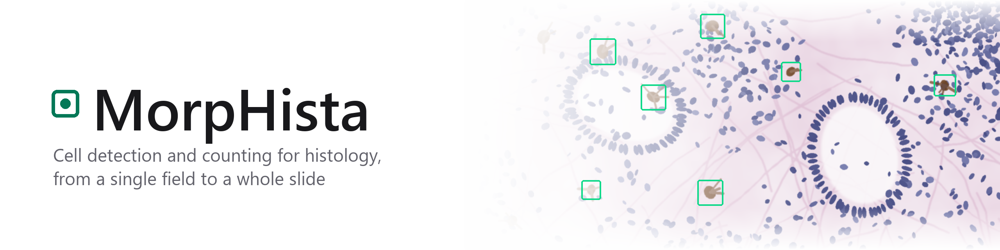

<picture>
  <source media="(prefers-color-scheme: dark)" srcset="docs/banner-dark.png">
  
</picture>

<p align="center">
  <a href="https://doi.org/10.3390/cells14070550"></a>
  <a href="LICENSE"></a>
  
  
</p>

**MorpHista** is a desktop application for detecting and counting cells in histological images. It finds interstitial cells of Cajal (ICC) and astrocytes with RF-DETR deep-learning models, measures the tissue area, and reports cell density per mm² of tissue. It handles anything from a single field of view to a 1.5-gigapixel whole-slide TIFF.

## Contents

- [Features](#features)
- [Quick start](#quick-start)
- [Models](#models)
- [Output files](#output-files)
- [Performance](#performance)
- [Development](#development)
- [Citation](#citation)
- [License](#license)

## Features

- **Detect and count.** Runs an RF-DETR model over overlapping tiles of the image. Overlapping and touching boxes are merged into one cell. The result is the number of cells, a per-class breakdown (white and grey matter for astrocyte models) and the density per mm² of tissue.
- **Tissue mask.** Separates tissue from the bright slide background with a brightness cut-off. You can drop small pieces below a set area.
- **Segment cells.** With an RF-DETR segmentation model, saves one labelled mask per cell.
- **Whole-slide images.** Results open in a tiled viewer at full resolution. Scroll to zoom, drag to move, and use the minimap or 1:1 zoom to check single cells.
- **Batch processing.** Analyse a single image or a whole folder. Every result is saved next to the images.
- **Physical units.** Pixel size is read from TIFF resolution tags, or entered manually.
- **Settings profiles,** plus light and dark themes.

## Quick start

You need Windows 10 or 11 (64-bit), an internet connection for the first start, and about 12 GB of free disk space. An NVIDIA GPU makes detection fast; without one it runs on the CPU, much more slowly. No programming tools are needed.

1. **Download** `MorpHista-<version>.zip` from the [Releases](../../releases) page (the newest is at the top). It includes the trained ICC model.
2. **Unpack.** Right-click the downloaded file, choose **Extract All…**, and pick a place to keep the program, for example *Documents*. Do not start the program from inside the ZIP file.
3. **Start.** Open the extracted folder and double-click **Start MorpHista**.
   - If Windows says *"Windows protected your PC"*, click **More info**, then **Run anyway**.
   - The first start downloads Python, PyTorch and the other packages the program needs (about 5 GB). This takes 5–20 minutes, depending on the connection; a black window shows the progress. Keep it open.
   - When it is done, the program opens and a **MorpHista** shortcut appears on your desktop.
4. **Next time**, double-click the desktop shortcut.

In the program:
1. Choose the cell type and a model.
2. Pick an image or a folder.
3. Press **Detect and count**.

**If something goes wrong:** start *Start MorpHista* again. If the program does not open, the file `morphista.log` in the program folder holds the details; send it to the author.

**Update:** download and extract the new release, then start it once the same way (the shortcut is updated).
**Remove:** delete the program folder and the desktop shortcut.

## Models

Trained models are not part of the repository. Put them under `models/`, in any subfolder. Both RF-DETR checkpoints (`.pth`) and ONNX exports (`.onnx`) work. The file or folder name tells MorpHista what a model is for:

| Name contains | Meaning |
|---|---|
| `icc`, `cajal`, `intestinal` | ICC model |
| `astro` | astrocyte model |
| `seg` | segmentation model (otherwise detection) |

To train your own model on a dataset in COCO format, put it in `training/datasets/icc` or `training/datasets/astro`, then run `pixi run train-icc` or `pixi run train-astro`. The best checkpoint lands in `models/` and is picked up automatically.

## Output files

All files are written next to the analysed images:

| Folder | Files |
|---|---|
| `Detections/` | `<image>_Annotated.jpg` with the detected cells boxed, plus `results.csv` with one row per image: areas, cell count, classes, density, pixel size |
| `Masks/` | `<image>_Mask.jpg`: the tissue mask over the image |
| `CellInstanceMasks/` | `<image>_CellInstances.png` (16-bit label per cell), `<image>_CellMask.png`, `<image>_CellInstances_Overlay.jpg` |

## Performance

Measured on a 39 600 × 38 016 px (1.5 Gpx) JPEG-compressed TIFF with an RTX 5090 laptop GPU:

| Step | Time |
|---|---|
| Tissue mask, end to end | 10.5 s |
| Detect and count (RF-DETR Large, 2 224 tissue tiles of 4 224) | 63 s |

TIFF tiles are decoded on all CPU cores. Detection runs on the GPU in FP16, in batches. Tiles with less than 1 % tissue are skipped; you can turn this off in *Detection settings*.

## Development

The environment is managed with [pixi](https://pixi.sh):

```bash
git clone https://github.com/edlmar/MorpHista.git
cd MorpHista
pixi run start
```

| Command | What it does |
|---|---|
| `pixi run start` | run the app (the first run installs the environment) |
| `pixi run -e dev build` | package the app as `dist/MorpHista/MorpHista.exe`; put `models/` next to the `.exe` |

`Start MorpHista.cmd` does the same for users: it installs pixi and the environment on the first start, creates the desktop shortcut, and starts the window with `pythonw` (no console; output goes to `morphista.log`).

```
app.py                  entry point
morphista/
  config.py             paths, analysis settings, settings file
  imaging.py            image reading, JPEG output, tissue mask, overlays
  models.py             RF-DETR / ONNX models and model discovery
  detection.py          tiling, merging of boxes, class counts
  pipelines.py          Detect and count, Tissue mask, Segment cells
  viewer.py             deep-zoom tiles for the result viewer
  ui.py                 the desktop window
  static/               style sheet and viewer script
```

## Citation

If you use MorpHista in your research, please cite:

```bibtex
@article{Fisere2025,
  author = {Fišere, I. and Edelmers, E. and Svirskis, Š. and Groma, V.},
  title = {Utilisation of Deep Neural Networks for Estimation of Cajal Cells in the Anal Canal Wall of Patients with Advanced Haemorrhoidal Disease Treated by LigaSure Surgery},
  journal = {Cells},
  year = {2025},
  volume = {14},
  number = {7},
  article-number = {550},
  doi = {10.3390/cells14070550},
  url = {https://doi.org/10.3390/cells14070550}
}
```

GitHub also offers this citation under **Cite this repository**, from [CITATION.cff](CITATION.cff).

## License

[PolyForm Strict 1.0.0](LICENSE). Free for noncommercial use. Redistribution and modification are not permitted.

## Contact

Edgars Edelmers – edgars.edelmers@disroot.org, or open an [issue](https://github.com/edlmar/MorpHista/issues).
